# Building Goodday

## From a family app to a governed service

### A field story of AI-assisted building, connected systems, and human oversight

Goodday began as a family chores app. It grew into a practical way to explore what one builder could create with AI agents, how a small product could connect to wider service practices, and where human judgment belongs when software can propose and carry out changes.

The work started with an everyday need: help a household coordinate chores, review completed work, and share rewards. As the app grew, it brought new questions about identity, data, deployment, operations, and AI. Those questions connected a family product to ideas that teams often discuss separately: software delivery, enterprise architecture, service management, and AI governance.

This book follows the Goodday journey from its first useful version through a more deliberate production foundation, a service model, and AI-assisted workflows with human review. The point is to share design choices and lessons that can help other builders.

At the center is one moment: an agent would not skip an established approval gate when I felt urgency. That experience made questions of authority, safety, and recovery immediate. The technology mattered, but the human decisions around it mattered more.

This is a personal field account, illustrated with selected screenshots of the Goodday app. It is intended for practitioners and curious builders who want to see how product work, AI assistance, and service thinking can meet in one project.

## Contents

### Part One · The Application
- 1 A household problem with a larger question
- 2 The MVP earned another iteration
- 3 When a useful app became a system
- 4 Rebuilding the foundation
- 5 A reliable foundation
- 6 AI and identity in a household product

### Part Two · ServiceNow in Context
- 7 Why connect the application to ServiceNow
- 8 Agile stories connect intent to evidence
- 9 Delivery evidence and clear approvals
- 10 Event Management makes operations visible
- 11 CSDM and Enterprise Architecture give the service context
- 12 AI systems in business context
- 13 Product releases and business value

### Part Three · People and the Agent
- 14 The gate that would not move
- 15 Guardrails need an emergency path
- 16 What agentic work changed
- 17 What useful progress looks like
- 18 Lessons for the next build

### Field guides
- Appendix A A journey in six movements
- Appendix B Working glossary
- Appendix C Architecture at a glance
- Appendix D Information domains and AI oversight
- Appendix E Reading the service model
- Appendix F Practices for caring for a service
- Appendix G A review lens for dependable services
- Appendix H Feedback to reviewed change
- Appendix I Operational signals without household content
- Sources and further reading

## Part One · The Application

## 1 A household problem with a larger question

Goodday's first job was clear. Adults create chores, choose who should do them, set a schedule and value, and review submitted work. Family members see their assignments, mark work complete, and request rewards. Reminders help bring the next task back into view. The app did not begin as an enterprise platform. It began with the ordinary friction of keeping a household coordinated.

That small setting mattered to the experiment. A household app has real people, uneven routines, personal information, and children. Features cannot be evaluated only by whether the screen renders or the API returns a result. An adult needs to understand what a child sees. A chore needs to return to the list if it is declined. A proposed edit should not silently replace the household's own decision. Even a small product has rules about identity, permission, and trust.

I carried three larger questions into that work. Could ServiceNow's products describe governance from an application change all the way to business capabilities, operating signals, technology risk, and AI use? Could an LLM help me build and maintain an application that would normally require a much larger team? And could agentic workflows increase a person's capacity without giving software more authority than the organization intended?

The three questions were linked. A release changes a live service. That service depends on a database, an identity provider, and possibly AI and notification services. A model can propose changes to family data. The development process needs to show what was requested, approved, tested, and deployed. ServiceNow offered a way to represent those relationships using work items, services, CIs, events, and governed AI assets.

Goodday was a useful test subject precisely because it was small enough for one person to understand but complete enough to expose real delivery problems. It included a browser app, a backend, a database, identity, notifications, AI, integration endpoints, and ongoing operations. The code could stay small while the governance questions kept expanding.

## 2 The MVP earned another iteration

An AI-assisted first version brought the core chores and rewards workflow to life quickly. Using a working product made it easier to refine features around actual household routines and to focus each iteration on something the family could use.

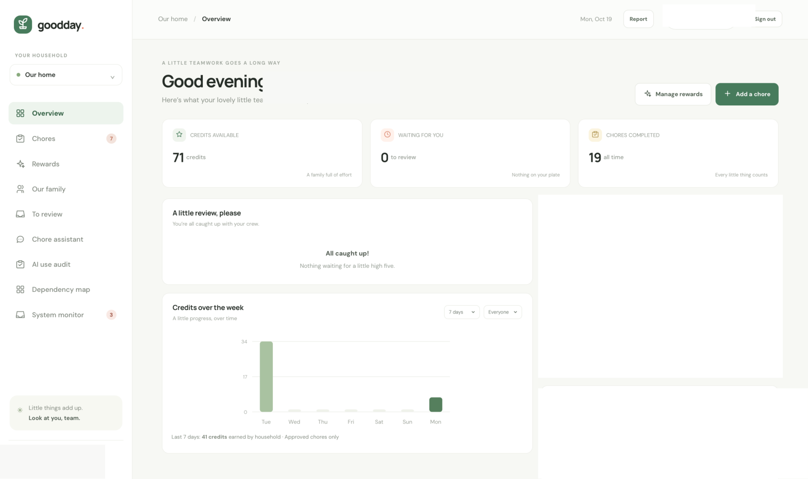

*The signed-in overview brings chore activity, review, and rewards into one household view.*

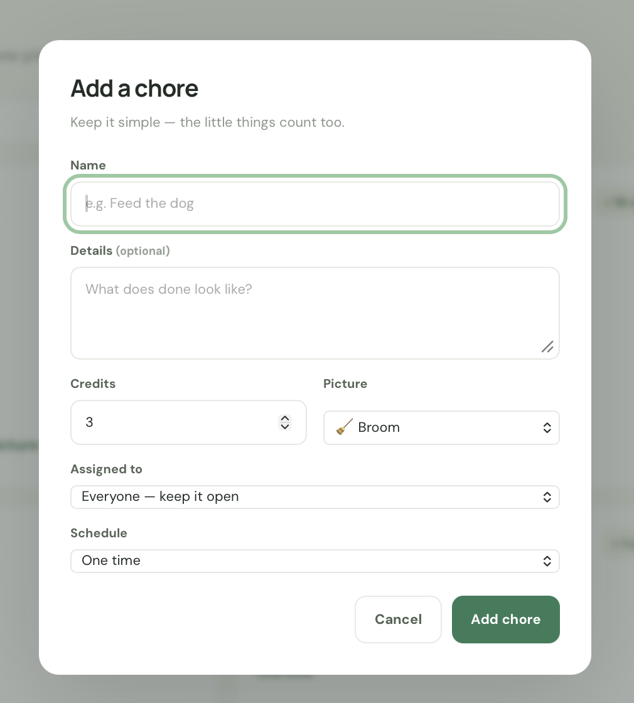

*The chore form makes assignment, schedule, and credit value explicit.*

The earliest project sessions in the available history show that the work quickly moved beyond chores. They include reward points, SMTP setup, an AI sample-generation request, Siri integration with the PWA, and an incremental upgrade plan. The session titles do not reveal every detail of those conversations, but they show a recurring pattern: build a working slice, use it, find the next edge, then widen the app carefully.

One early design decision turned out to be important. Goodday's assistant can draft a chore change, but the system presents it as a proposal. An adult reviews and confirms it before the household record changes. Picture generation also produces a private preview that requires approval. The chore and reward cycle itself contains a human review step: submitted work waits for an adult decision before credits are awarded.

Those features were not introduced as a formal theory of AI governance. They arose from what a family product should do. Yet they supplied a practical first example of human oversight. A model can be useful without becoming the decision-maker. It can reduce the effort needed to draft a chore or create an illustration, while leaving the actual household decision with an adult.

The MVP also changed the economics of experimentation. A feature that might once have required a project proposal could now be tried in a focused iteration. That did not make every idea worth building. It made the cost of exploring an idea lower, which increased the need to choose well and stop when a feature did not serve the family.

## 3 When a useful app became a system

As Goodday grew, the work shifted from screens and features to system behavior. The app added recurring schedules, member profiles, separate adult and child experiences, completion review, credit snapshots, reward exchanges, reminders, feedback reports, AI-aided chore authoring, image generation, and external tool access through the Model Context Protocol.

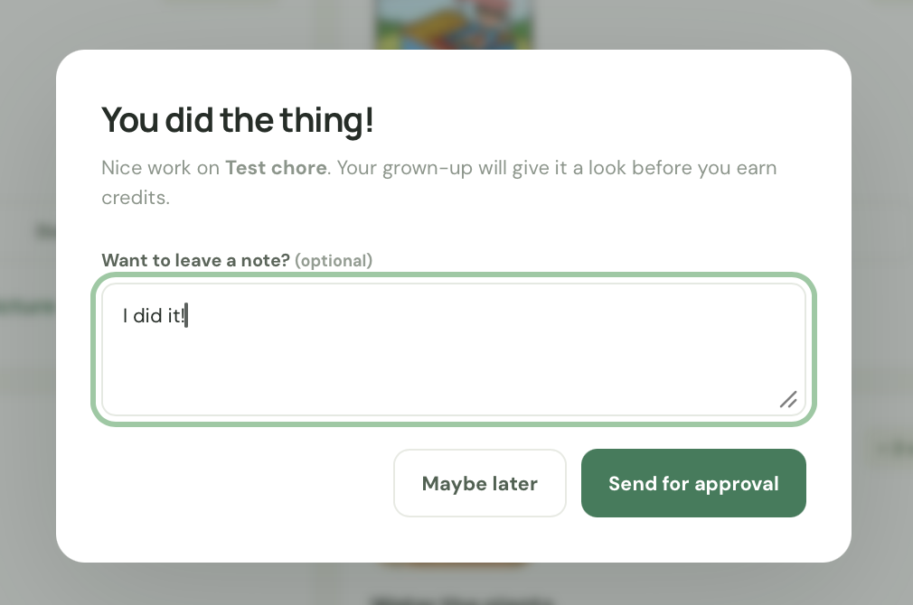

*A member submits completed work for an adult to review.*

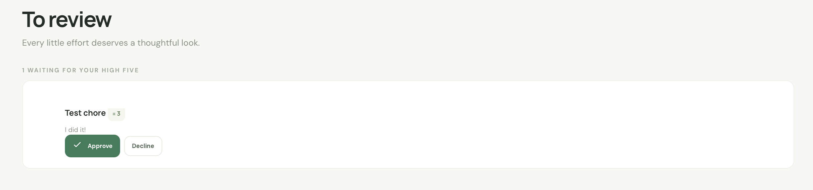

*An adult reviews the submitted work before the chore is credited.*

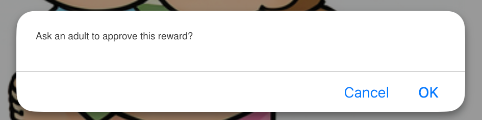

*A reward request makes the next household decision visible.*

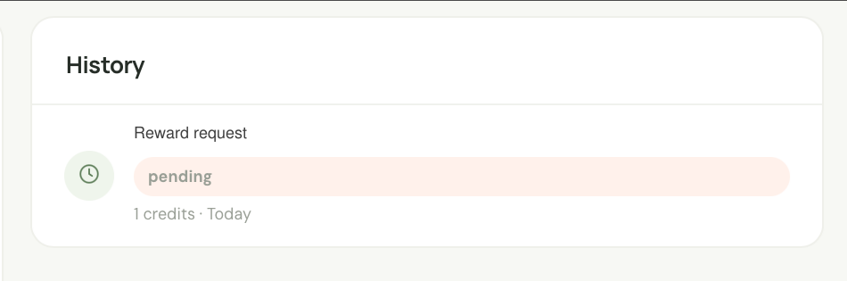

*The request remains visible while it awaits an adult decision.*

Several boundaries became visible. A pending completion needs to hold the chore until an adult reviews it. A declined completion needs to make it available again. A change to a member's identity or management permission should revoke relevant sessions. A model-generated picture should stay private until approval. A tool client that can read household data should not automatically gain permission to change it.

These are small-scale examples of enterprise concerns. They map to data consistency, authorization, audit, workflow, lifecycle, and service operations. The point is not that a family app has the same risk profile as a bank or hospital. The point is that reliable software has to preserve decisions and boundaries regardless of scale.

Goodday's AI use audit was designed to record useful operational context without copying sensitive conversation content into the application's own audit table. It records the actor, channel, provider or tool, status, timing, data categories, and review outcome. It does not keep prompts, model answers, MCP arguments or results, raw coordinates, or generated image bytes in that audit. That choice narrows what a later reviewer can learn, but it also avoids building a second copy of family content into the audit trail.

The codebase also had to become easier to reason about. The initial Express and SQLite implementation did not need to be thrown away to make the next architecture possible. It became the source for a one-time data import and a behavioral reference. The production runtime moved elsewhere. That separation let the project preserve a useful first version while changing the platform underneath it.

## 4 Rebuilding the foundation

The production backend became a Java 21 Spring Boot service with PostgreSQL and Flyway migrations. The React application is built and served from the same Java deployment. Caddy terminates public HTTPS. Docker Compose defines the application, database, migration, and restricted recovery processes. A second instance of the Java image exposes account recovery on host loopback, separate from public traffic.

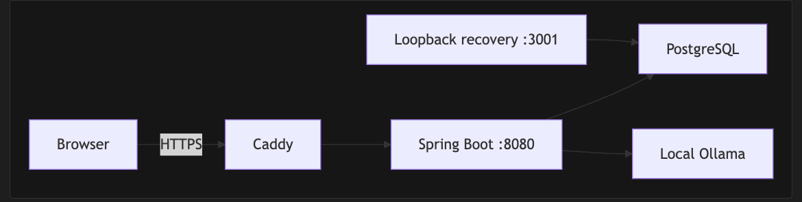

*The deployment separates the public edge, application runtime, and durable data store.*

The transition had a concrete data-safety requirement. Existing household data needed to move from SQLite into PostgreSQL without losing members, chores, reward balances, OAuth grants, sessions, pictures, notifications, or audit history. The migration procedure takes a consistent SQLite snapshot, verifies integrity and schema version, copies into an otherwise empty PostgreSQL database in one transaction, checks row counts, and rolls the target back if the import fails. The old application remains available as a migration source and behavior reference; it is not the production runtime.

The architecture also created clearer boundaries. Java owns authentication, APIs, MCP, scheduled work, and the compiled browser UI. Flyway owns schema evolution. PostgreSQL is private on Compose networks. Caddy is the public edge. The recovery process binds to the host loopback interface. Those choices make the deployment easier to describe and help keep the database and local recovery flow out of public reach.

Google OAuth provides sign-in, while Goodday still owns household roles and its application sessions. Email, browser push, and local or remote Ollama endpoints are optional integrations. They are configured separately so the app can distinguish what is always required from what a particular household has enabled.

This was a significant step beyond vibe coding a first release. It meant planning a migration, deciding where configuration lives, managing database changes, separating public and recovery traffic, protecting secrets, and rehearsing backup and restore. The project became a modular monolith rather than a set of microservices. That kept the deployment proportionate to a single-household service while allowing the code to have clear package boundaries.

Project architecture and operations notes describe that design in detail. Their most useful contribution to this story is the reasoning behind each boundary and how it supports future changes.

## 5 A reliable foundation

A production app is more than its screens and features. It also needs a clear data model, a dependable runtime, controlled configuration, secure identity, and a recovery plan. I used the Beyond Twelve-Factor extension as a practical review lens to look across those concerns.

Goodday moved from an Express and SQLite MVP to a Java 21 Spring Boot service with PostgreSQL and Flyway migrations. The React application is built and served by the same Java deployment. Docker Compose describes the application and database, while Caddy provides the public HTTPS edge. The result is a modular monolith with boundaries that are easy to explain.

The migration preserved the household's existing records while changing the production foundation. That work made the system easier to operate and gave future changes a clearer path through schema, application, and deployment.

A review framework is most useful when it turns abstract goals into questions a builder can act on. It helped me connect architecture choices to the needs of a real household service, and to make reliability part of the product conversation from the beginning.

## 6 AI and identity in a household product

As the application grew, it gained familiar sign-in, optional notifications, local AI services, and an integration surface for approved tools. Google sign-in gave invited household members a straightforward way to access the app. The Model Context Protocol endpoint created another path for tools to interact with Goodday.

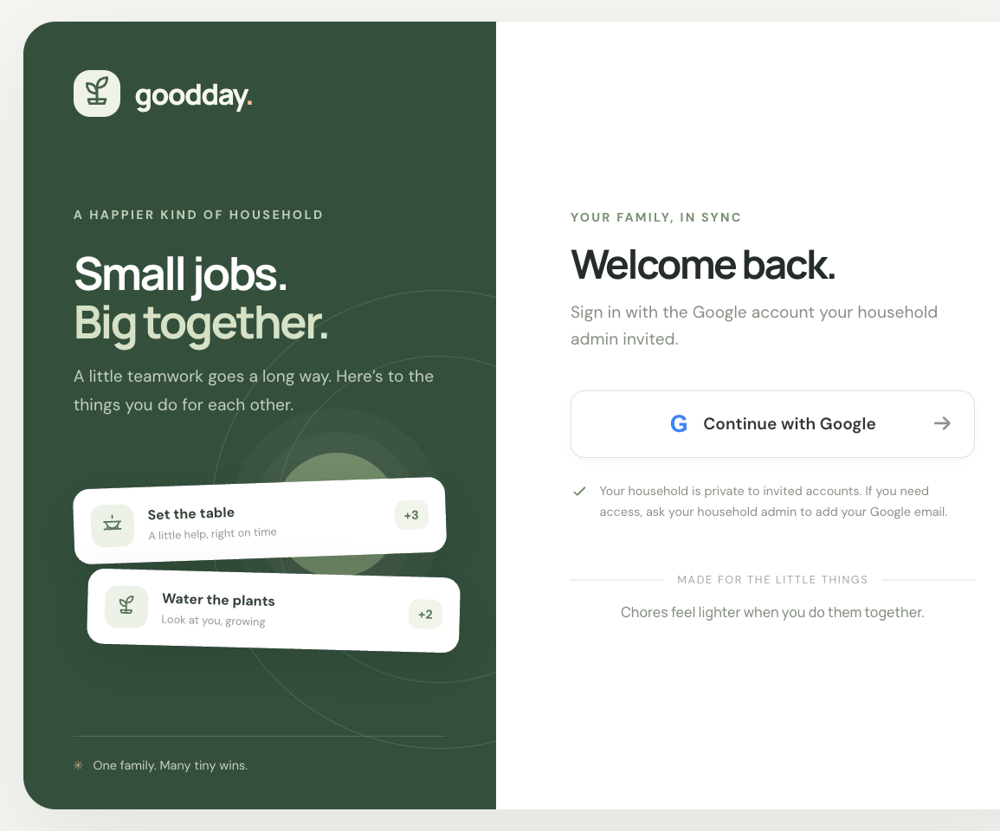

*Invited household members use Google sign-in to access Goodday.*

Goodday's AI capabilities support the chore-to-review-to-reward loop. The chore assistant can draft a change in everyday language. The illustration flow can create a private preview. A feedback workflow can help turn an owner's issue or feature request into a structured story draft.

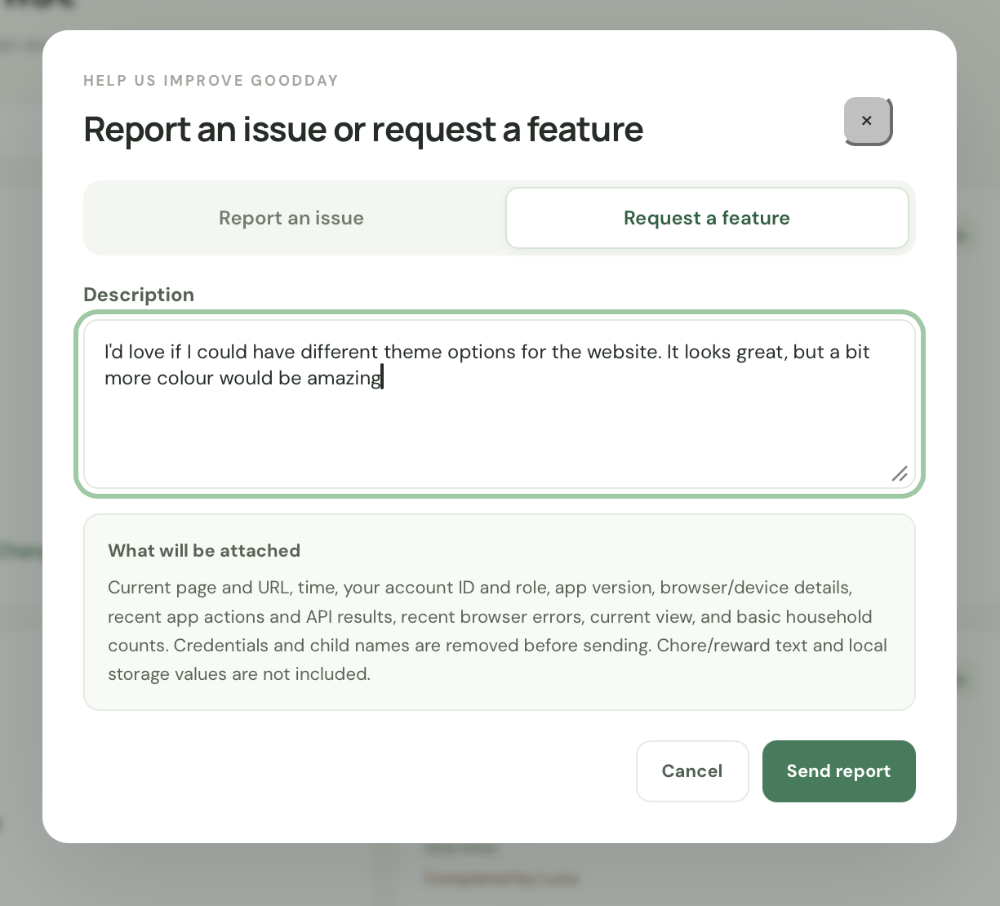

*An owner can submit an issue or feature idea from within the product.*

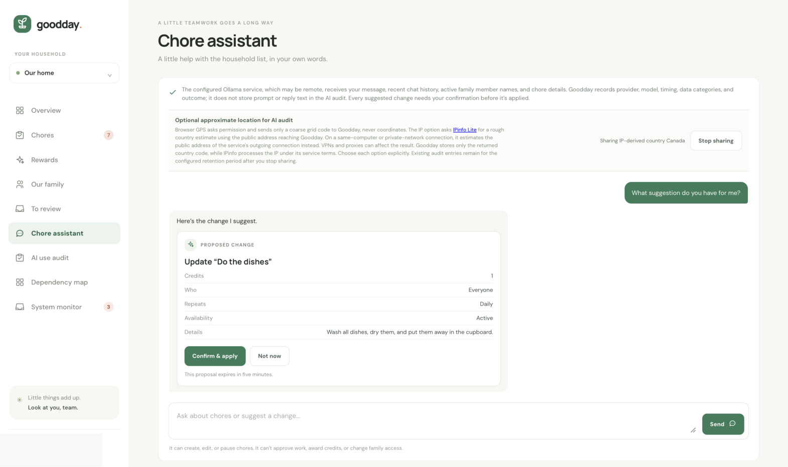

*The assistant stages a proposed chore change for adult review.*

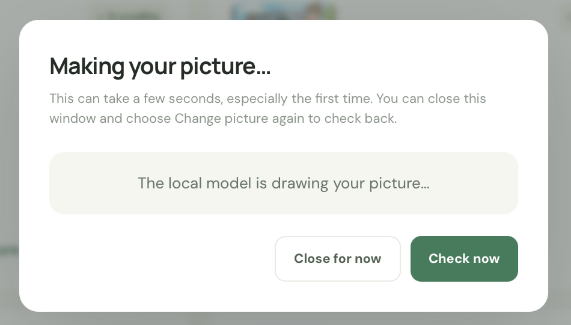

*A generated illustration is held in a private preview during review.*

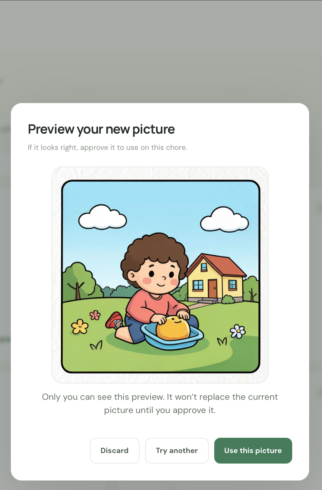

*An adult decides whether a generated image becomes part of the household experience.*

The app places a person at the decision point. An adult reviews a proposed chore change before it is applied and decides whether a generated image should be approved. AI can reduce the effort of drafting or illustrating an idea while leaving the household decision with the adult.

That boundary is especially important in a family product. Household schedules, profiles, and routines can be sensitive. The design gives optional integrations a clear purpose and keeps review visible. Goodday also records useful interaction metadata for an owner without copying conversation text into its audit trail.

Goodday's external tool interface makes its permissions visible. An owner can limit which tools an approved client may call and review the region the client declares before granting access. The declaration helps a person assess the request; it does not independently verify where the external client processes data.

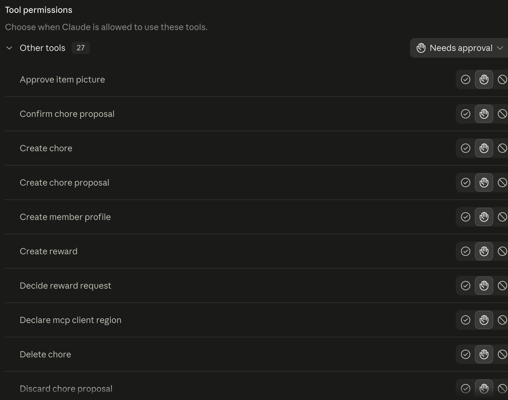

*The permissions view makes an external client's allowed tools explicit.*

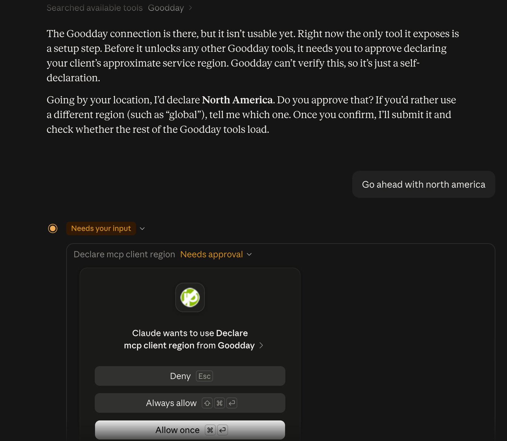

*The consent step makes the client's declared processing region visible to the owner.*

The wider lesson is that an AI feature belongs inside a product workflow. Its value depends on whether it helps people do something useful while preserving their control over the result.

## Part Two · ServiceNow in Context

## 7 Why connect the application to ServiceNow

I wanted to understand how a business could see an application across its product, operations, architecture, and AI use. ServiceNow offered a shared language for those views.

Goodday provided a concrete example. Agile Development 2.0 could describe requested work. DevOps Change Velocity offered a model for connecting source, tests, artifacts, and approvals. Event Management could receive operating signals. CSDM and Enterprise Architecture could relate the application to business capabilities and the services that support them. AI Control Tower offered a way to place AI systems in the context of the business applications they serve.

The important idea was connection. A developer, an application owner, an operations team, an architect, and an AI steward can all ask different questions about the same service. A shared model helps those views inform each other.

That made ServiceNow more than a collection of product names in the story. It gave me a way to explore how operational and business context can travel together.

The same application can be described from several useful viewpoints. A product owner cares about the experience and the outcomes it supports. A delivery team needs a clear account of requested changes and the evidence behind them. An operator needs to know whether the service is healthy and which dependency may be involved. An architect needs to see how applications, capabilities, information, and technology relate. An AI steward needs to understand where automated systems participate and where people retain control.

Those viewpoints should connect without being collapsed into one record. A story explains a unit of intended work. A release describes a controlled delivery. A service represents the experience being operated. A configuration item describes a managed component. An AI system record describes a governed use of AI. The relationships between these records create context; their distinct meanings make that context trustworthy.

This is why the platform question was interesting to me. The goal was not to put every detail in one database or to make every team use the same screen. It was to let each role work with the evidence it needs, then follow the connections when a question crosses from one role to another.

## 8 Agile stories connect intent to evidence

A useful change begins with a reason. Agile stories gave Goodday a way to carry that reason into implementation, testing, and release work.

The work process gave each change a description and acceptance criteria before implementation. The story could be associated with the product and release context, and the repository commit could point back to the request. After the work was complete, its summary and evidence could be recorded with the delivery record.

That connection changed the rhythm of small changes. Instead of moving straight from a prompt to code, the work had an explicit purpose and a way to discuss whether it was complete. A feedback inbox gave household owners another path to submit ideas and follow how they became delivery work.

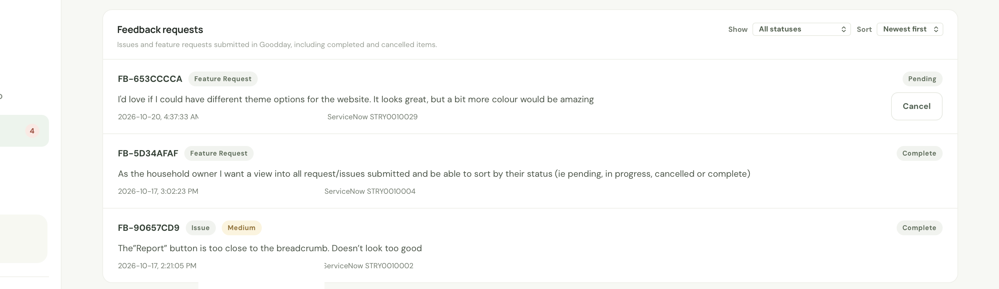

*The inbox gives an owner a place to review feedback and its related work.*

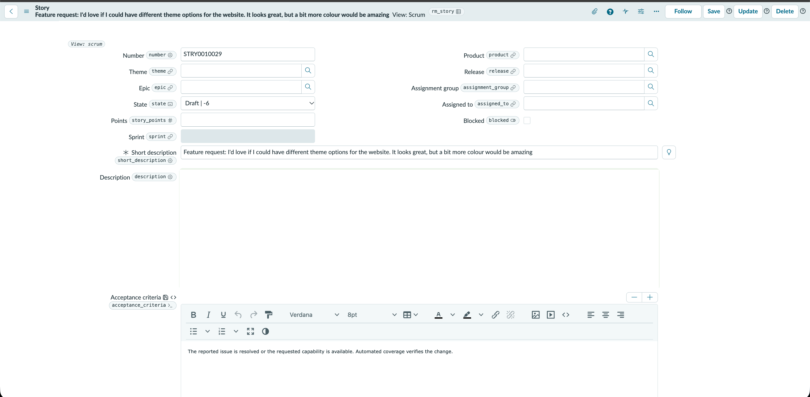

*An AI-assisted draft can organize feedback for a person to review before it enters delivery.*

Traceability helps answer simple questions: Why did we make this change? What did we intend? What evidence supports the result? Those records make the work easier for people to understand and maintain.

A useful story is more than a title. It names the person or workflow affected, the behavior that should change, and the observable conditions that would make the change acceptable. For example, a chore-assistant improvement might specify that the assistant can suggest a schedule but cannot alter an approved chore until an adult confirms it. The acceptance notes can then cover both the expected suggestion and the boundary around applying it.

The story can also keep product intent close to technical evidence. A commit describes the implementation; automated checks show what was exercised; a release record connects the change to the service it affects. When a person returns to the work later, those links help reconstruct why a particular implementation exists. They also make a review more specific: the question becomes whether this behavior and its evidence satisfy the request, rather than whether the code merely looks plausible.

AI assistance fits at the beginning of this chain. It can group a report into a concise summary, suggest acceptance criteria, or identify a missing detail. The person who raised the issue can correct the draft, and the product owner decides whether and when it becomes planned work. This keeps the model's contribution legible and preserves prioritization as a human responsibility.

## 9 Delivery evidence and clear approvals

A release brings several kinds of evidence together: the requested change, the source revision, checks, artifacts, and the approval that allows work to continue. DevOps Change Velocity offered a way to think about those pieces as one delivery story.

ServiceNow's delivery model connected work, source, checks, and approvals to a release path. Considering Goodday through this lens showed how a change can be discussed as a sequence of named evidence, rather than one green light.

The most useful lesson was about clarity. Each handoff should have an owner, a clear state, and evidence that explains what happened. A person should be able to follow the change from the original request to the service it affects.

That is a design principle for agent-assisted delivery as well. An agent can prepare changes and collect evidence, but people need a clear view of what has been proposed, checked, approved, and released.

It helps to treat delivery as a chain of distinct evidence. A source connection identifies where code came from. A build turns that source into an artifact. Tests provide evidence about selected behavior. A release record identifies the thing being promoted. An approval expresses a decision by an authorized person or policy. A deployment record connects the promoted artifact to the running service. Each link answers a different question, so one green indicator should not stand in for the whole chain.

An approval gate is strongest when the person reviewing it can see the scope, the evidence, the expected impact, and the recovery option. A low-risk documentation change may need a lighter review than a database migration or an identity change. The process should make that difference explicit, while still leaving an audit trail that explains who approved what and under which rule.

Agents can help assemble this evidence. They can summarize a change, connect a test result to an acceptance note, and point out when a release record lacks context. They should not turn their own successful execution into permission to deploy. The authority to advance a change belongs to the release policy and the people responsible for it.

## 10 Event Management makes operations visible

A service model becomes useful when it helps people understand how the application is doing. Goodday's operational view includes service health, runtime measures, database connectivity, and selected aggregate counts. A ServiceNow Event Management integration can carry privacy-minimized signals into an operations workflow.

The integration connects an event to the service and dependencies it describes. That gives an operator more context than a free-floating alert: which application is affected, which part of the runtime produced the signal, and which business service depends on it.

The privacy choices matter. The event path can describe service conditions without forwarding household conversations or sensitive account content. It makes operations more visible while respecting the purpose and boundaries of the household app.

This was one of the clearest examples of the value of a shared platform: a product's own health information can be read alongside the service relationships that explain why it matters.

Signals become easier to act on when each one has a clear owner and lifecycle. A readiness check can say whether the application can serve traffic. A dependency check can identify whether the database is reachable. A request measure can show changing latency or error rates. A queue measure can reveal work that is waiting too long. The event should carry a stable service identity, a bounded category, a timestamp, and enough severity context to route the issue.

An event is not the same as a metric, a log entry, or an alert. Metrics help reveal patterns over time. Logs help an operator investigate a particular execution. Events communicate a condition that may need attention. Alert rules decide whether and how that condition reaches a person. A service map adds dependency context. Keeping those roles distinct prevents a dashboard or a single notification from being mistaken for operational understanding.

The event also needs a lifecycle. A continuing condition should update the same signal rather than create an unbounded list of duplicates. A recovery sample should close or clear it. The person on call needs to understand what changed and whether the service returned to a healthy state. A privacy-minimized payload makes this easier to do without exporting the household request, model prompt, or image that happened to be present when a failure occurred.

## 11 CSDM and Enterprise Architecture give the service context

CSDM and Enterprise Architecture helped describe Goodday as a business application supported by services and technical components. The model connected household capabilities such as planning chores, reviewing work, and managing rewards to the application services that deliver them.

The technical view can then be related to the wider service model. A service model helps people understand the components and relationships that support the application without turning the narrative into an inventory of development records.

That relationship changes how people can ask questions. A business owner can begin with the household outcome. An operator can follow the service to its application and dependencies. An architect can see how applications, capabilities, and information flows fit together.

The model is most valuable when it helps people understand the same system from different roles. It turns configuration items into context that can support service and business conversations.

The vocabulary matters because these objects have different jobs. A Business Application names a logical product in a portfolio. A Business Capability describes something the business needs to be able to do. An Application Service represents the running service through which people receive the product. Configuration Items represent managed components that support that service. Information Objects describe meaningful data domains without copying a table schema into an architecture view.

Relationships carry the explanation. A business application can be associated with the capabilities it enables and the information it creates or uses. An application service can be related to the business application it delivers. The service can then connect to the components that support its runtime. A relationship should describe a real dependency or lifecycle association, not merely provide a convenient path between two records.

This model is useful even before it is automated. A logical view helps a team agree on boundaries and ownership. Discovery and reconciliation can add evidence about deployed components, but they should not be used to guess business meaning. Conversely, a polished business architecture view does not prove that every technical dependency is current. A trustworthy model says what kind of evidence each relationship represents.

For Goodday, that meant describing a family product in terms people could understand: coordinate household work, review completion, and manage rewards. Technical services and components support those outcomes, while information domains explain the kinds of data that move through the product. The model stays useful when it lets a household-oriented conversation and an operator-oriented conversation refer to the same service without forcing either person to learn the other's entire vocabulary.

## 12 AI systems in business context

AI governance becomes more practical when an AI system is connected to the business applications and services that use it. Enterprise Architecture and AI Control Tower offer a way to describe that relationship.

Goodday helped me think about several kinds of AI use: a chore assistant, an illustration workflow, and a feedback story drafter. Each has a different purpose, interaction pattern, and place in the product. The assistant supports a household decision; the illustration workflow creates a private preview; the feedback drafter helps turn a suggestion into work for the product team.

A useful AI inventory should help people understand what a system is for, which application it supports, what kind of data it handles, and where a person reviews its output. Those are questions that connect AI stewardship to product ownership and service architecture.

The project made that connection tangible. AI governance is easier to discuss when it is grounded in an application people can understand and a workflow with visible human decisions.

An inventory is most useful when it distinguishes the layers of an AI feature. The user-facing feature has a purpose and an owner. The AI system describes the governed capability. A model or prompt asset describes a component that may change independently. An inference endpoint describes where requests are processed. An external agent or MCP client is another system, with its own operator and downstream behavior. Treating these as separate but related objects makes it easier to ask who is accountable for each decision.

The association to a business application gives governance a practical starting point: which product uses this AI capability, which people are affected, and what workflow depends on it? A steward can then ask what information is involved, how the output is reviewed, what happens when the provider is unavailable, and how changes to the model or prompt are assessed. These questions connect inventory to product ownership rather than treating it as a list of model names.

Usage evidence needs the same care. A product audit can record that a feature was used, what broad data category was involved, whether the request succeeded, and whether a person reviewed the result. A trace may capture technical execution details for a supported monitoring path. Neither should automatically become a transcript store. Each destination should have a clear purpose, a data allowlist, an owner, and a retention rule.

An MCP server and the external client that calls it should also remain distinct in the model. Goodday can enforce its own user roles, scopes, and tool permissions. It cannot infer what an external client does with data after receiving an authorized response. Governance should therefore record the boundary that the product controls and leave downstream claims to the system's own owner and evidence.

## 13 Product releases and business value

The product story also needs a business view. For Goodday, the outcome is household coordination: make work clear, give people a way to review it, and connect effort to shared rewards.

Enterprise Architecture provides a language for relating applications to capabilities and information. Application and technology portfolio practices can help teams discuss how software supports outcomes and how changes fit into a product's lifecycle.

The value of that structure is not a score on a card. It is a better conversation between the people responsible for the product, the service, and the business result. A household app gave me a concrete way to ask how technology choices support the experience a family wants.

Connecting product, release, and business context can help an organization talk about value throughout a service's life, not only at the point of purchase or deployment.

The conversation benefits from precise measures. A capability score is not a business outcome, and a release count is not a measure of customer value. A useful value discussion begins with an outcome people recognize, identifies how the product contributes, and chooses evidence that can actually be observed. For a household product, that might mean clearer assignments, fewer missed reviews, or a reward process that family members understand. For an enterprise service, the equivalent measure depends on its users and business purpose.

Portfolio practices can then connect that outcome to product and technology decisions. Lifecycle information helps teams see which underlying technologies deserve attention. Release planning helps them coordinate the delivery of changes. Architecture connects applications to the capabilities they support. These views provide context for a decision; accountable owners still have to interpret the evidence and decide whether an investment is justified.

An end-to-end example makes the connections concrete. An owner reports that a recurring chore is difficult to assign. A reviewed story captures the user need and the expected behavior. An agent can help draft the change and prepare code. Checks and a build provide evidence about the implementation. An authorized person approves the release. Operational signals show how the service behaves afterward, while the application model connects the product to its capabilities and supporting services. Each step contributes a different kind of confidence, and no single step substitutes for the others.

The value of a joined-up platform is therefore not that it produces an automatic business answer. It helps people see the request, the service, the technology, and the outcome in a shared context so they can make a better-informed decision.

## Part Three · People and the Agent

## 14 The gate that would not move

The moment I keep returning to is an approval gate that did not yield when I wanted to restore the application's operations. I told the agent that I approved the action. It would not skip the pre-established gate. In that moment, “rebellious LLM” felt like an accurate description. I was serious, the situation felt urgent, and the system appeared to care more about a process than my authority.

That was my reaction in the moment, not a claim that the model had independent intent. What mattered was the boundary I encountered: a conversational request and a formal approval are not always the same thing.

The experience made agent authority feel practical rather than theoretical. An agent can help prepare a change, gather information, and explain the next step. It should not invent permission to bypass a control when urgency rises.

The question that stayed with me was how to make an approval process clear to the people who rely on it. A guardrail should explain its authority and lead an operator toward an approved path, especially when restoring a service.

## 15 Guardrails need an emergency path

A durable approval process includes a clear path for urgent work. That path has an owner, a bounded scope, an audit trail, and a way to return to normal controls.

An agent can help an operator find the right procedure, prepare a request, review a rollback plan, and collect evidence. The authority to grant an exception belongs to people and policies that the organization has chosen in advance.

A guardrail that is understandable is easier to use under pressure. The system should identify what approval is needed, who can provide it, and how the operator can move toward recovery without guessing what wording will persuade the model.

This principle applies beyond software release. Any workflow in which an agent can propose or carry out an action should make the boundary between assistance and authority visible.

## 16 What agentic work changed

AI agents changed the range of work I could explore as one builder. They helped across the interface, backend, tests, migrations, documentation, and integrations. That made it possible to connect product decisions with the technical and operational questions around them.

The most useful shift was not simply generating code faster. It was being able to keep a broader view of the product while exploring one concrete change at a time. An agent could help inspect a feature, suggest an implementation, update the related documentation, and prepare evidence for review.

Clear tasks made the collaboration more effective. A useful request described the affected area, the expected behavior, the constraints, and how a person would judge the result. The agent could then contribute within a boundary that remained visible to the builder.

The experience changed what one person could attempt, while keeping human judgment central. The builder still chooses what matters, reviews the proposed changes, and decides which work is ready to become part of the product.

## 17 What useful progress looks like

Progress in an AI-assisted product should be judged by the experience it creates and the confidence people have in the result.

For Goodday, useful outcomes include clearer household coordination, fair review of completed chores, and a reward loop people understand. The AI features should make those steps easier while preserving adult judgment and household control.

For the development process, speed matters alongside quality, maintainability, and clear evidence. A change is useful when it helps the product without making its behavior harder to understand or operate.

These measures connect technical work to the reason the application exists. They also make room for learning: builders can ask whether a new capability reduced friction, strengthened trust, or helped people make a better decision.

## 18 Lessons for the next build

### Begin with a user and a decision

Goodday started with a household job people could recognize. Governance choices became meaningful when they helped a family coordinate work and make clear decisions.

### Let architecture follow a real constraint

The Java and PostgreSQL foundation answered practical needs around durable data, identity, migration, operations, and recovery. A modern stack matters when its boundaries support the product.

### Use precise language for the system

A product, a running service, a configuration item, and a business capability describe different parts of the same system. Clear names help people connect those views without confusion.

### Treat a workflow as a design surface

An approval gate is part of the user experience. It should explain its authority, its current state, and the next action.

### Preserve useful evidence

Project records, test results, and operational signals help people understand why a change happened and what it affected. Good evidence supports review without collecting more personal content than the workflow needs.

### Connect technology to business context

CSDM and Enterprise Architecture make it possible to relate technical services to the capabilities and outcomes they support.

### Give agents clear roles

Agents can help move work forward when they have enough context, clear permissions, and reviewable results. People remain responsible for intent, authority, and final decisions.

## Closing

Goodday gave me a place to explore the overlap between a useful product, application delivery, ServiceNow, and AI agents. It began with a household need and grew into a broader study of what a small team can make when product, engineering, and service thinking are connected.

ServiceNow provided a shared language for work, services, business capabilities, operations, and AI systems. AI agents helped me work across more parts of the product. Human review kept the household decisions and approval boundaries in view.

The approval gate remains the most human lesson. An agent can help people move through a process, but it should not invent authority for itself. Clear guardrails and a clear recovery path make that relationship more useful for everyone.

That is what I wanted to understand: how AI can help build more than a prototype, and how to design the work around it so people remain able to see, guide, and own the result.

## Appendix A A journey in six movements

The journey can be read as six movements. The early product milestones are drawn from the builder's account; later work is reflected in project notes and selected records.

| Movement | What took shape |
| --- | --- |
| A household problem | Goodday began as a chores and rewards app for a family. |
| A useful first version | The app grew into a working household workflow with assignments, review, and rewards. |
| A durable foundation | Identity, data migration, a Java and PostgreSQL backend, and a more deliberate deployment model supported the growing product. |
| A service in context | CSDM, Enterprise Architecture, and operational signals connected the application to the services and capabilities around it. |
| AI with human review | The chore assistant, illustration workflow, and feedback drafter kept people in the decision loop. |
| Agents and authority | An approval gate became a practical lesson in how people and agents share responsibility. |

## Appendix B Working glossary

- **Agile Development 2.0**: ServiceNow work-tracking product for stories, epics, features, releases, and related delivery records.
- **AI Control Tower (AICT)**: ServiceNow product area for AI system inventory, lifecycle, and governance.
- **Application Service**: An operational view of an application instance and the components and dependencies that deliver it.
- **Business Application**: A logical portfolio record for a product, distinct from a running service or configuration item.
- **CSDM**: Common Service Data Model, ServiceNow guidance for organizing business applications, services, configuration items, and their relationships.
- **CI**: Configuration item, a record representing an application, server, database, service, or other managed component.
- **DPR**: Digital Product Release, a ServiceNow product release process.
- **DVC**: DevOps Change Velocity, which relates DevOps toolchain activity to change, test, artifact, and release evidence.
- **DIM**: Digital Integration Management, used in Enterprise Architecture to describe interfaces, integrations, APIs, and information flows.
- **EA**: Enterprise Architecture, the practice and workspace for relating applications, capabilities, information, and technology.
- **IRE**: Identification and Reconciliation Engine, ServiceNow's mechanism for identifying and reconciling configuration items.
- **MCP**: Model Context Protocol, used by Goodday to expose scoped household tools to approved external clients.
- **TPM and TLM**: Technology Portfolio Management and Technology Lifecycle Management, ServiceNow practices for technology portfolio and lifecycle context.
- **Service Mapping and Discovery**: ServiceNow capabilities for identifying deployed components and relating their dependencies.

## Appendix C Architecture at a glance

A useful architecture overview explains how a person reaches the application, where household decisions are made, where durable data lives, and which capabilities connect to outside services.

| Layer | Goodday example | Why the boundary matters |
| --- | --- | --- |
| Public edge | Caddy provides HTTPS and routes traffic to the application. | It separates public access from the private application and data network. |
| Application | A Java service serves the React/PWA experience, APIs, identity integration, household rules, and optional AI workflows. | The service keeps product behavior and authorization in one place. |
| Data | PostgreSQL stores household state; Flyway describes schema changes. | Durable state and explicit schema evolution support predictable application changes. |
| Identity | Google sign-in identifies a person; Goodday assigns household roles and access. | A federated identity and product permissions answer different questions. |
| Optional connections | Email, browser push, AI inference, and approved external tools extend the product. | Optional services can be understood by purpose, direction, and the data they need. |

Goodday is a modular monolith. Its application areas have clear responsibilities while sharing one product and one household data model. That keeps the deployment proportionate to a family service and gives builders a structure they can explain as the application grows.

## Appendix D Information domains and AI oversight

Thinking in information domains helps a team discuss sensitivity and purpose without copying every database table into an architecture catalog.

| Domain | Examples | Design focus |
| --- | --- | --- |
| Household and identity | Household, member profiles, roles, and management access | Keep account identity distinct from Goodday's household role decisions. |
| Chores and assignments | Task instructions, schedules, assignee, and credit value | Share only the task context needed for the requested feature. |
| Completion and review | Submitted work, adult decision, reviewer, and credit snapshot | Keep review visible and preserve the decision that awards credit. |
| Rewards | Reward catalogue, cost, request, and decision | Make earning and spending rules understandable to household members. |
| Illustrations | Approved images and private previews | Keep generated previews private until an adult approves them. |
| Notifications | Email and browser push subscriptions and delivery preferences | Make optional channels explicit and protect recipient information. |
| Authentication and external tools | Federated sign-in, household roles, scoped credentials, and approved MCP tools | Keep identity, household authorization, and tool scope distinct. |
| AI and external tools | Interaction metadata, provider or tool labels, categories, and review outcome | Give owners useful oversight while limiting the content copied into audit records. |
| Optional location | Coarse location shared after an adult action | Make the purpose explicit, ask before collecting it, and avoid retaining precise coordinates. |
| Operations | Health checks, aggregate metrics, and incident summaries | Use operational signals to find the affected service without copying household activity into the monitor. |

Goodday's AI audit is designed to retain operational context without copying raw prompts or responses. The chore assistant presents suggestions for adult review, and the illustration workflow keeps previews private until approval. These choices keep the AI feature within a human-owned product workflow.

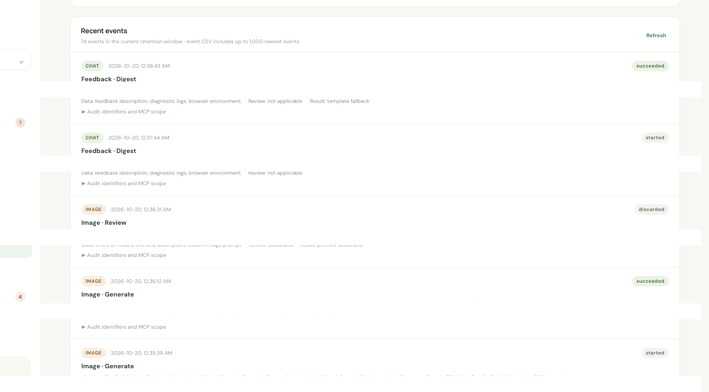

*The audit view emphasizes interaction metadata and review outcomes while keeping conversation content out of the record.*

Useful audit fields include the interaction channel, provider or tool label, outcome, timing, data categories, and whether a person reviewed the result. The record is designed to exclude prompts, model responses, raw tool arguments, and generated image content. That gives an owner a way to see how a feature was used without creating another store of household conversations.

An external MCP client is a separate trust boundary. Goodday can limit the tools and scopes it makes available and record the client's declared processing region. It cannot independently observe the client's downstream provider or prove where the client processes data. A region declaration is useful context for a review, not a substitute for one.

### What an owner can learn

An audit event can describe who initiated an interaction, which channel handled it, what category of information was involved, how the action ended, and whether a person reviewed the result. This helps an owner compare product behavior without turning the audit table into a transcript archive. It also lets a reviewer distinguish a household-facing assistant from an external tool call or an illustration request.

The audit and the application serve different purposes. The application holds household records and approved images; the audit holds limited context about the use of AI-related features. Database access, backups, exports, and retention policy remain part of the same privacy boundary. A log should support a decision without collecting every input that produced it.

Location is a separate, optional data path. When a household feature needs it, an adult should initiate the request and understand the purpose before granting browser permission. A coarse location category can support a broad contextual feature without keeping an exact coordinate. Any exported audit file or backup should follow the same access and retention choices as the primary record.

| Oversight question | Goodday design principle |
| --- | --- |
| Who is accountable? | Keep the household owner and the authorized reviewer visible in the product workflow. |
| What information is needed? | Send only the context required for the requested task; keep raw conversation content out of the usage audit. |
| Who can act? | Scope external tools and require an adult to approve changes to household state. |
| What can be reviewed later? | Preserve action category, outcome, timing, and review context without keeping the full prompt or response. |
| How long is it retained? | Choose a retention period that fits the purpose and apply it to backups and exports as well. |

## Appendix E Reading the service model

A service model connects a product's purpose to the systems and decisions that support it. Each layer answers a different question.

| Concept | Question it answers | Goodday example |
| --- | --- | --- |
| Business Application | Which product are people using? | Goodday Family Chores as one logical application. |
| Business Capability | What does the organization need to do? | Plan household work, review completion, and manage rewards. |
| Application Service | Which running service delivers the product? | The Goodday household web service. |
| Configuration Item | Which managed component supports the service? | Application, database, edge, or runtime components. |
| AI System | Which AI-enabled system supports a product workflow? | Chore assistance, illustration, or feedback drafting. |
| Operating event | What signal may need an operator's attention? | A privacy-minimized service or dependency health event. |

ServiceNow capabilities fit into this picture in complementary ways. Agile Development 2.0 relates requested work to delivery context. DevOps Change Velocity provides a model for source and test evidence around change. Event Management connects operating signals to services. CSDM and Enterprise Architecture relate applications to capabilities and runtime services. AI Control Tower provides a governance view of AI systems and their business context.

### Keep the layers distinct

| Layer | What it represents | Relationship principle |
| --- | --- | --- |
| Business Capability | An ability an organization needs | Describe the outcome people need, not a software component. |
| Business Application | A logical product used to support work | Relate the product to the capabilities it helps deliver. |
| Application Service | A running service that delivers the product | Connect the product to the service people depend on. |
| Configuration Item | A managed runtime or dependency | Relate components to the service they support. |
| AI System | A governed AI-enabled capability | Link its purpose to the applications that use it, then describe any real runtime separately. |
| Information Object | A logical category of information | Use categories to discuss impact; do not place household payloads in the architecture catalog. |

These distinctions help keep architecture conversations coherent. A logical product is not the same thing as a deployed runtime. A model inventory is not the same thing as a server inventory. A service relationship explains how components contribute to an outcome; it is not a copy of the application's database structure.

The same idea applies to lifecycle and change records. A story describes intent, a release groups work, a runtime service describes delivery, and an event describes an operating condition. Keeping those roles separate makes it easier to connect them without treating every record as interchangeable.

Those concepts are most useful when their distinctions stay clear. A Business Application describes the product people use. A Business Capability describes an organizational ability. An Application Service describes a running service that delivers the product. Configuration items describe managed components. An AI System describes a governed AI-enabled capability; it is not automatically a server or a service dependency. Separating these views helps an organization ask the right question at each layer.

## Appendix F Practices for caring for a service

The product experience depends on more than feature code. These practices connect everyday use to the work that keeps an application understandable and dependable.

| Practice | A useful question |
| --- | --- |
| Product behavior | Can a household member understand the next step and the decision an adult will make? |
| Change intent | Is the reason for a change clear, with a simple way to review its result? |
| Identity and access | Does the application distinguish sign-in from the permissions a household role grants? |
| Data and schema | Is durable state protected, and can the application explain how its data model changes? |
| Operations | Can an operator understand service health and find the right service context for a signal? |
| AI use | Is the purpose of each AI feature clear, including what information it needs and where a person reviews its output? |
| Recovery | Do people know who can authorize urgent work and how the system returns to its normal approval path? |

These questions help a builder connect product decisions to operations, service context, and human responsibility. They apply whether an application is managed by one person or a larger team.

### A routine operating cycle

| Moment | Practice | Why it matters |
| --- | --- | --- |
| Before a release | Review the reason for the change, its checks, and the approval that authorizes it. | The person operating the service can follow the change from intent to result. |
| During operation | Review service health, runtime pressure, and dependency readiness. | Aggregate signals help an owner find the affected part of the service. |
| Before recovery is needed | Keep protected backups and a named recovery procedure. | A backup is valuable when an operator can locate and use it. |
| During a restore drill | Restore in an isolated environment and inspect core application state. | Practice shows whether the recovery steps are understandable and repeatable. |
| After an incident | Record a useful summary, impact, and outcome without storing household conversations. | Future review can improve the service without widening the data collected. |

The habits are deliberately small. A family service does not need a large operations organization to benefit from clear health signals, protected recovery copies, and an explicit release decision. Those practices make the service easier to explain and support.

| Operating practice | A dependable habit |
| --- | --- |
| Health and readiness | Check whether the application can answer requests and whether its required dependencies are ready. |
| Backups | Protect backup copies with access controls and keep them separate from everyday application data. |
| Restore drills | Practice restoring a backup in an isolated environment so recovery is a known procedure. |
| Incident review | Preserve enough context to understand impact and recurrence without collecting raw household content. |
| Release review | Connect the request, code change, checks, and human approval so a later operator can follow the change. |

Operational evidence works best as a small set of signals with clear owners. A monitor can summarize response behavior, runtime health, and dependency readiness; a deeper investigation can use protected service logs and recovery records.

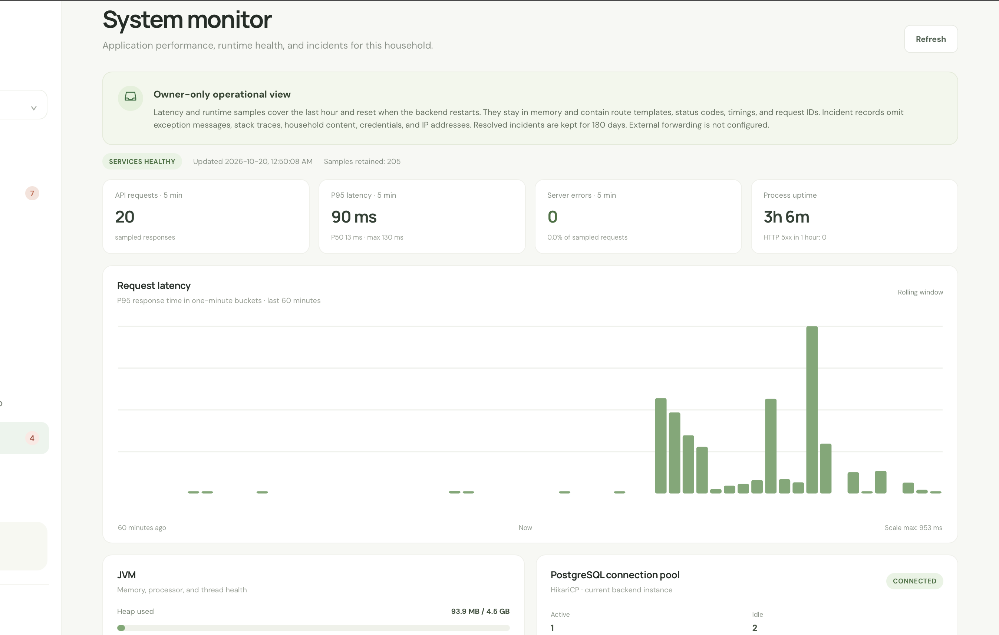

*An owner-facing monitor gathers service health and runtime signals in one view.*

## Appendix G A review lens for dependable services

A factor review turns a broad claim such as “ready for production” into questions a team can answer with evidence. The Beyond Twelve-Factor extension is useful as a discussion guide across the software lifecycle; its value comes from the questions it prompts, not from a score.

| Factor | Questions to ask |
| --- | --- |
| Codebase | Does one coherent codebase make it possible to understand and review the product? |
| Dependencies | Are dependencies declared, pinned, and updated deliberately? |
| Configuration | Can environment-specific settings change without editing application code? |
| Backing services | Are databases, identity, notifications, and AI endpoints treated as explicit dependencies? |
| Build, release, and run | Can a change be tied to its source revision, checks, artifact, and release decision? |
| Processes | Are application processes stateless where practical, with durable work stored in a reliable system? |
| Port binding | Are public interfaces and private dependencies separated intentionally? |
| Concurrency | Does shared durable state coordinate concurrent work safely? |
| Disposability | Can the service start, stop, and recover without losing important state? |
| Development and production parity | Can a representative environment exercise the same service boundaries without household data? |
| Logs | Do logs help an operator understand an event without collecting unnecessary personal content? |
| Admin processes | Are migrations, backups, and other one-time operations documented and repeatable? |
| API first | Are the product's interfaces understandable, documented, and testable? |
| Telemetry | Can the team see service health, latency, and dependency behavior at the right level? |
| Authentication and authorization | Are identity, household roles, tool scopes, and approval decisions distinct and testable? |

The review is most useful when people write down what evidence supports an answer and revisit it after the service changes. An implemented feature, a rehearsed operating procedure, and a proven recovery path are different kinds of evidence. A clear review keeps those distinctions understandable without reducing the service to a grade.

For example, an image-generation change touches more than the model call. A review can ask whether the provider is configured outside the code, whether the job can be retried, how the preview stays private, which adult approves the result, what the audit records, and how an operator understands a failed request. Those questions connect product behavior, infrastructure, authorization, and recovery in one feature-sized discussion.

The review is useful at different scales. A small product can answer a few questions before each release. A larger organization can use the same factor names to compare services, assign owners, and decide what evidence belongs in a portfolio review. The method does not prescribe a score; it helps people state the evidence behind their judgment.

## Appendix H Feedback to reviewed change

Feedback is a bridge between product use and product work. A household owner can describe a problem or idea in the app. An AI-assisted workflow can organize that report into a structured story draft, while a deterministic template remains available when model assistance is unavailable or the result fails validation.

The workflow has four deliberate steps: capture the request, prepare a draft, validate its structure, and let a person decide whether it belongs in the work queue. This keeps model assistance useful even when a draft needs correction or a person chooses a different priority.

| Step | What it contributes |
| --- | --- |
| Capture | The owner describes an issue or idea in context. |
| Prepare | The assistant organizes the description into a draft with a clear title and acceptance notes. |
| Validate | The application checks that the draft has the expected shape and uses a deterministic fallback when needed. |
| Review | A person edits, accepts, defers, or declines the proposed work. |

The workflow still belongs to people. A draft is a starting point: the owner can correct it, decide whether it reflects the request, and choose what should enter the work queue. Keeping the draft visibly separate from an approved story prevents a helpful suggestion from becoming an unreviewed commitment.

This pattern applies beyond Goodday. AI can reduce the effort of shaping an idea for a delivery process while leaving prioritization, acceptance, and release authority with the people responsible for the product.

| Responsibility | Assistant can help with | Person remains responsible for |
| --- | --- | --- |
| Understand the request | Group related details and suggest a concise summary | Confirming what the owner meant and what outcome matters |
| Prepare the story | Drafting a title, context, and acceptance notes | Editing the language and choosing the actual acceptance criteria |
| Check the result | Validating structure and flagging missing fields | Deciding whether the request belongs in the backlog |
| Move work forward | Linking a reviewed request to the delivery process | Prioritizing, approving, and accepting the change |

The fallback path matters because it keeps the product usable when model assistance is unavailable. It also makes the authority boundary clear: the model can prepare a candidate record, while the person decides whether that record becomes work.

## Appendix I Operational signals without household content

Operational signals can help an owner understand a service without forwarding the private information that service handles. Useful signals include availability, dependency readiness, aggregate request volume, error rates, latency, queue size, and the state of a service's runtime resources.

An event should identify the service and the condition that needs attention. A stable event identity helps an update refer to the same condition rather than creating an unrelated alert each time. Recovery signals should make it possible to recognize when the condition clears.

Goodday's design keeps household conversations, prompts, responses, raw tool arguments, image bytes, and personal location out of operational event payloads. This makes the signal more useful for service operations and reduces the amount of household data carried into monitoring systems.

The principle is simple: collect enough context to guide an operator toward the affected service and next step, while keeping the underlying household content in the product's own protected workflow.

| Signal group | Useful examples | Keep out of the payload |
| --- | --- | --- |
| Application health | Readiness, request volume, error rate, response latency | Request bodies, account details, raw routes, and session tokens |
| Runtime health | Process availability, memory pressure, thread state, connection-pool pressure | Environment secrets and personal identifiers |
| Dependency health | Database readiness and service availability | Household records and database credentials |
| AI and tool outcomes | Aggregate success, denial, review, and failure counts | Prompts, responses, images, raw tool arguments, and external-client secrets |

An operational signal should help answer “what needs attention?” and “which service is affected?” It should not become a second channel for collecting the information the application is designed to protect.

### A signal's lifecycle

1. Measure a bounded service or dependency condition.
2. Normalize the signal to a stable service identity and useful category.
3. Send an aggregate event with enough context to route it to the right operator.
4. Update the same event as the condition continues or changes.
5. Close it when healthy behavior returns.
6. Review the outcome without attaching household content to the event.

This sequence keeps operations connected to the service model while preserving a clear boundary between telemetry and the private records that make the product useful.

## Sources and further reading

This public account draws on the builder's recollection, product and architecture notes, and selected screenshots of the Goodday app. Personal details in the illustrations have been redacted.

This is a first-person field account of one application and its design choices. It is not a product certification or a quantified productivity study. ServiceNow products and workspaces vary by release and configuration.

### Selected ServiceNow references

- [Agile Development 2.0 story guidance](https://www.servicenow.com/docs/r/it-business-management/agile-development/create-a-story.html)
- [Enterprise Architecture and Digital Integration Management](https://www.servicenow.com/docs/r/application-portfolio-management/eaw-explore-digital-integ-management.html)
- [Event Management web service](https://www.servicenow.com/docs/r/it-operations-management/event-management/send-events-via-web-service.html)
- [CSDM guidance](https://www.servicenow.com/docs/r/application-portfolio-management/align-with-csdm5.html)
- [AI Control Tower and Enterprise Architecture](https://www.servicenow.com/docs/r/application-portfolio-management/eaw-aict.html)
